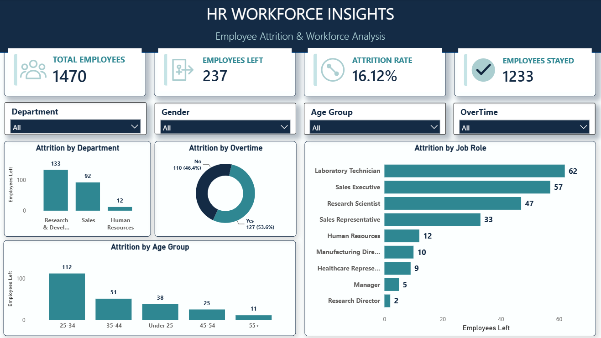
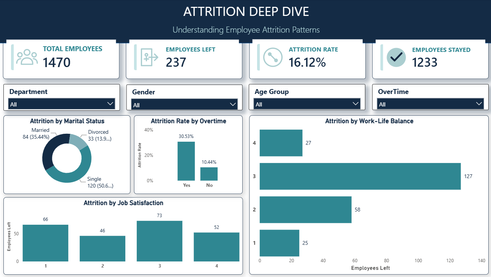

# HR Workforce Analytics & Employee Attrition Analysis

## Project Overview

This project analyzes employee workforce data to understand employee attrition patterns and identify factors associated with employees leaving an organization.

The analysis uses Python for data cleaning, MySQL for data analysis, and Power BI for interactive dashboard development.

The goal is to transform raw HR data into meaningful business insights that can help HR teams better understand workforce trends and support data-driven decision-making.

## Project Objectives

- Analyze overall employee attrition and retention.
- Identify departments and job roles with higher attrition.
- Understand the relationship between overtime and employee attrition.
- Analyze attrition patterns across different age groups and marital statuses.
- Explore the impact of job satisfaction and work-life balance on attrition.
- Build an interactive Power BI dashboard to present key HR insights.

## Tools & Technologies

- **Python:** Data cleaning and data quality checks.
- **Pandas:** Data manipulation and preparation.
- **MySQL:** Data storage and SQL-based analysis.
- **Power BI:** Interactive dashboard development and data visualization.
- **DAX:** Calculated measures and KPI creation.
- **Jupyter Notebook:** Python analysis environment.

## Dataset Information

- **Dataset:** IBM HR Analytics Employee Attrition & Performance
- **Total Records:** 1,470 employees
- **Original Columns:** 35
- **Columns After Cleaning:** 32
- **Target Variable:** Attrition

### Data Cleaning

Data cleaning and preparation were performed using Python and Pandas.

- Checked for missing values.
- Checked for duplicate records.
- Verified EmployeeNumber uniqueness.
- Removed three constant columns: EmployeeCount, Over18, and StandardHours.
- Performed basic business-rule validation on employee data.
- Exported the cleaned dataset as `hr_employee_attrition_cleaned.csv`.

No employee records were deleted during the cleaning process.


## SQL Analysis

MySQL was used to analyze employee attrition and workforce trends.

The analysis covered:

- Overall employee count and attrition rate.
- Employee attrition by department.
- Attrition by job role.
- Attrition by age group.
- Attrition by gender and marital status.
- Attrition based on overtime.
- Job satisfaction and work-life balance analysis.
- Employee experience and tenure analysis.
- Comparison of employees who left and those who stayed.

SQL queries were used to calculate employee counts, attrition rates, and workforce distributions.

## Key Findings

- **Overall Attrition Rate:** 16.12% (237 out of 1,470 employees).
- **Overtime:** Employees working overtime had a higher attrition rate (30.53%) compared with employees not working overtime (10.44%).
- **Job Role:** Sales Representatives had the highest attrition rate at 39.76%.
- **Age Group:** Employees under 25 had the highest age-group attrition rate at 39.18%.
- **Marital Status:** Single employees had a higher attrition rate (25.53%) than married employees (12.48%) and divorced employees (10.09%).
- **Work-Life Balance:** Employees reporting the lowest work-life balance had an attrition rate of 31.25%.

These findings highlight workforce segments with higher observed attrition and can help HR teams identify areas for further investigation.


## Power BI Dashboard

An interactive two-page dashboard was developed using Power BI to visualize workforce trends and employee attrition.

### Workforce Overview


### Attrition Deep Dive


### Page 1: Workforce Overview

- Total Employees
- Employees Left
- Attrition Rate
- Employees Stayed
- Attrition by Department
- Employees Left by Job Role
- Employees Left by Overtime
- Employees Left by Age Group

### Page 2: Attrition Deep Dive

- Employees Left by Marital Status
- Employees Left by Job Satisfaction
- Employees Left by Work-Life Balance
- Attrition Rate by Overtime

### Interactive Features

- Department filter
- Gender filter
- Age Group filter
- OverTime filter
- Synchronized slicers across both dashboard pages

## Project Structure

```text
hr-workforce-analytics-employee-attrition/
│
├── data/
│   └── hr_employee_attrition_cleaned.csv
│
├── screenshots/
│   ├── HR_Workforce_Overview.png
│   └── HR_Attrition_Deep_Dive.png
│
├── python/
│   └── data_cleaning.ipynb
│
├── sql/
│   └── hr_analysis.sql
│
├── powerbi/
│   └── HR_Workforce_Insights_Dashboard.pbix
│
└── README.md
```

## Conclusion

This project demonstrates an end-to-end data analytics workflow, from data cleaning and SQL analysis to interactive dashboard development.

The analysis identified important employee attrition patterns related to job roles, overtime, age groups, marital status, and work-life balance.

The Power BI dashboard presents these findings in an interactive and easy-to-understand format, helping HR teams explore workforce trends and make more informed decisions.


- LinkedIn: [Connect with me](https://www.linkedin.com/in/sujit-samal-data-analyst/)
- GitHub: [View my GitHub profile](https://github.com/Sujit1028)